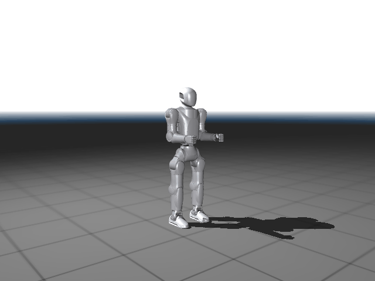

# robot · 启元 PRIMEBOT Q1 本地开发工作区

这个仓库是给 **上纬启元 PRIMEBOT Q1 人形机器人**（22 自由度，v2d0 本体，SDK `v0.1.2.7-R`）做本地开发的工作区。

**只包含我们自己写的部分：`q1-sim`** —— 在 WSL（Ubuntu 22.04）里搭起来的 MuJoCo 仿真 + ROS2 开发环境。
厂商的 URDF / SDK / 接口文档 **不入库**（版权归厂商），需要请从文末的上游仓库获取。

## 目录

| 路径 | 说明 |
| :--- | :--- |
| [`q1-sim/`](q1-sim/) | 主体：MuJoCo 仿真、ROS2 工作区脚本、动作编排与验收 |
| [`q1-sim/README.md`](q1-sim/README.md) | 完整文档：环境怎么搭、每一步的实测数据、怎么跑、踩过的坑 |
| [`q1-sim/docs/`](q1-sim/docs/) | 验证产物：动图、渲染图、轨迹数据 |

## `q1-sim` 做了什么

一套没有真机也能干活的环境：

- **22 个关节**（腿 6+6、腰 2、臂 4+4）与厂商 yaml / URDF / MJCF 三方的名字与顺序完全一致，可按名字直接驱动
- **消息层**：把厂商 `aimdk_msgs`（33 msg + 17 srv）编译进 ROS2 Humble，`JointCommand` 的六个字段与仿真内核一一对应，桥接层可以很薄
- **仿真层**：MuJoCo 3.16 里做 PD + 重力补偿，试验台工况稳态误差 **0.000°**、稳态饱和 0
- **动作层**：[`mujoco/motions.py`](q1-sim/mujoco/motions.py) 声明动作 → [`mujoco/trajectory.py`](q1-sim/mujoco/trajectory.py) 生成轨迹 → [`mujoco/play_motion.py`](q1-sim/mujoco/play_motion.py) 播放并**用可测量的判据验收形态**（不是"看着像"）
- **一键验收**：[`scripts/check_all.sh`](q1-sim/scripts/check_all.sh) 跑 8 项自检并重建全部产物

### 成果示例：复刻一段"挥手"



要求是"手肘高于肩膀，且小臂和大臂所在平面与躯干、头在同一个平面"。实测结果：

| 指标 | 结果 |
| :--- | :--- |
| 手肘高于肩膀 | 全程 **+0.083 ~ +0.137 m** |
| 小臂朝上（腕高于肘） | **+0.112 m** |
| 手臂平面 与 躯干/头平面 共面 | 最大夹角 **5.2°**（共面度 0.996） |
| 手臂是否**过**该平面（不只是平行） | 手肘偏离 ≤ **9.4 mm**、手腕 ≤ **0.9 mm**，摆动中不变 |
| 摆动轴行程利用率 | **99.6 %**（35.85° / 36.00°） |
| 跟踪误差 | **2.07°**（开前馈 **0.27°**） |
| 力矩饱和 | **0** / 242022 步 |

关键实现结论（坑都记录在 [`q1-sim/README.md`](q1-sim/README.md)）：

> `shoulder_yaw` 是**上臂中点绕上臂长轴的自转铰**，决定"手臂在哪个平面里弯"，**不是**用来摆动的关节。
> 要让小臂落回躯干/头所在的平面，得把 `shoulder_yaw` 固定（约 −85°）；
> 摆动则要用 `shoulder_roll` —— 它绕 x 轴转，而那个平面的法线正是 x，摆多少度都不会摆出平面。

## 快速开始

以下假设源码放在 `E:\robot`（WSL 里是 `/mnt/e/robot`），构建产物放 WSL 的 ext4（`~/q1_ws`、`~/q1_sim`），不放 `/mnt/e`。

```bash
# 1) 装 ROS2 Humble（只需一次，需要 sudo）
bash /mnt/e/robot/q1-sim/scripts/install-ros2.sh

# 2) 准备 Python 环境（MuJoCo / Pillow 等）
bash /mnt/e/robot/q1-sim/scripts/bootstrap_pip.sh

# 3) 编译厂商消息包 + 模型包
bash /mnt/e/robot/q1-sim/scripts/build_ws.sh

# 4) 在仿真里播一段挥手（--viewer 开交互窗口）
cd /mnt/e/robot/q1-sim/mujoco
~/q1_sim/venv/bin/python play_motion.py --motion wave --viewer

# 5) 一键全量验收（重建动图 + 打印所有实测指标）
bash /mnt/e/robot/q1-sim/scripts/check_all.sh
```

> `q1-sim/README.md` 里的路径都按"源码在 `E:\robot\q1-sim`、构建产物在 WSL 的 `~/q1_ws` / `~/q1_sim`"这套布局写的，换位置需要相应调整。

## 上游（厂商）资料

本仓库**不转载**厂商文件，需要的从这里取：

- 接口文档 + SDK：<https://atomgit.com/primebot/q1-dev-guide>
- URDF + mesh：<https://atomgit.com/primebot/q1-urdf>
- 启元机器人开发者社区：<https://dev.primebot.com/>

## 已知限制

- **真机联调在本机受限**：Windows 10 的 WSL2 只能走 NAT（不支持 mirrored 模式），DDS 多播发现出不去、且会把本机 locator 通告成 `172.21.x.x`，机器人按该地址回连必然失败。分析与对策见 [`q1-sim/docs/真机连接与WSL2_NAT.md`](q1-sim/docs/真机连接与WSL2_NAT.md)。
- **仿真增益是自检值，不是标定值**：仿真里的刚度/阻尼只是为了把动作跑稳，不能直接搬到真机。
- **低层关节伺服有物理风险**：厂商文档明确提示过，`joint_control.py` 需要先关掉运控模块再执行。